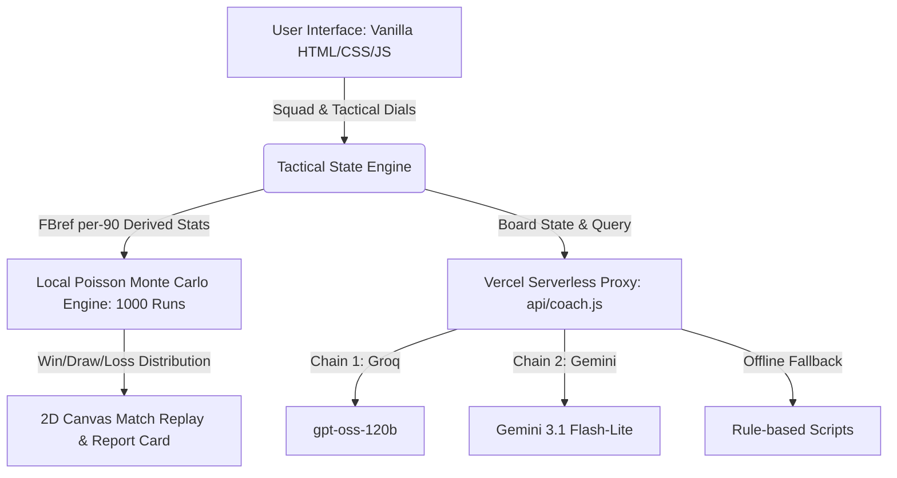

# K-Tactics Lab 2026

> 2026 북중미 월드컵 대한민국 국가대표팀 전술 솔루션 및 브라우저 몬테카를로 매치 시뮬레이터


2026 월간 해커톤 출품작 · 개인 프로젝트 · 2026.06  
[라이브 데모](https://k-tactics-lab-2026.vercel.app) · [시연 영상 (YouTube)](https://youtu.be/bIjaPrhZ708) · [대회 기획서](PROPOSAL.md)

## Motivation

K-Tactics Lab 2026은 대표팀 경기의 전술 선택을 팬이 직접 바꾸고 결과를 비교할 수 있도록 만든 브라우저 기반 시뮬레이터다.

당시 경기와 보도에서 드러난 빌드업, 측면 수비, 핵심 선수 활용 문제를 5종 포메이션과 전술 다이얼로 다시 구성하고, 각 선택이 팀 밸런스와 경기 확률에 어떻게 반영되는지 확인할 수 있게 했다.

## What It Does

- **스쿼드 및 5종 포메이션 샌드박스**: 대회 출전 기록이 있는 대한민국 선수 20인(선발 11명, 벤치 9명)을 기반으로 3-4-3, 4-3-3, 3-5-2, 4-2-3-1, 4-4-2 대형을 드래그 앤 드롭 및 클릭 스왑(Click-to-Swap)으로 자유롭게 교체.
- **3대 경기 국면 제어 및 실시간 팀 밸런스 HUD**: 공격 전개(하프스페이스 침투), 측면 수비(인버티드 풀백/스토퍼), 경기 운영(하프타임 체력 소모 및 교체) 다이얼에 따라 공격 파괴력·측면 수비·중원 장악력·체력 스탯 실시간 변동.
- **1,000회 Poisson 몬테카를로 매치 시뮬레이션**: 공식 FBref 통계 기반 기대 득점($\lambda$)을 유도해 브라우저에서 승/무/패 확률분포를 연산하고 2D 캔버스 90분 경기 중계 및 승부차기 재생.
- **멀티 프로바이더 LLM 체인 (Coach V & AI 상대 감독)**: Groq(`gpt-oss-120b`) → Gemini 3.1 Flash-Lite 체인을 통해 실시간 전술 그라운디드 조언 및 상대 감독의 카운터 전술 수립(장애 시 스크립트 폴백).
- **매치 리포트 명함 캡처 및 공유**: html2canvas 기반 2배수 고화질 PNG 명함 생성, Web Share API 네이티브 공유 및 URL 인코딩 도전장 링크 지원.

## Architecture



## Tech Decisions

| 영역 | 선택 | 이유 |
|---|---|---|
| 코어 프레임워크 | `Vanilla HTML5 · CSS3 · JS (ES6+)` | 프레임워크 빌드 step(`npm install`)과 패키지 설치 없이 정적 배포와 로컬 실행이 가능하도록 바닐라 웹 선택 |
| 매치 엔진 | `로컬 Poisson 몬테카를로 (1,000회)` | 승패 연산을 LLM과 분리하고, FBref 기반 $\lambda$와 로컬 Poisson 샘플링으로 검증 가능한 확률 계산과 런타임 $0 연산을 유지 |
| AI 레이어 | `멀티 프로바이더 LLM 체인 (Groq → Gemini)` | 단일 프로바이더 장애에 대비해 Groq을 우선 호출하고 Gemini로 폴백하며, Vercel 서버리스 함수로 API 키를 은닉하여 클라이언트 무인증 접근 제공 |
| 사운드 FX | `Web Audio API (실시간 합성)` | 외부 오디오 에셋 의존성을 제거하여 `file://` 오프라인 환경에서도 킥오프 휘슬 및 UI 효과음이 즉시 구동되도록 브라우저 내장 합성 적용 |
| 상태 관리 | `Native JS State & 이원화 인터랙션` | 외부 상태 라이브러리 없이 순수 JS 객체로 전역 상태를 관리하고, 트랙패드 환경을 위해 드래그 앤 드롭과 클릭 스왑(Click-to-Swap)을 동시 지원 |
| 배포 및 호스팅 | `Vercel (Static + Serverless Functions)` | 정적 자산은 글로벌 CDN, LLM 프록시만 서버리스 함수로 분리하여 상시 인프라 운영 비용 $0 유지 |

## Results & Limitations

- **확률 모델 검증**: 고정 보드에서 해석적 Poisson 정답과 200,000회 샘플 결과가 일치했고, 앱 설정인 1,000회 반복은 승률 추정 표준편차 ±0.9%p로 정수 단위 확률 표시에 맞췄다.
- **데이터 파이프라인 검증**: 대한민국 실제 출전 20인의 FBref 원자료를 4대 능력치로 변환하고, 검증 스크립트([`scripts/verify_raw.py`](scripts/verify_raw.py))로 261개 측정 필드의 원자료 일치를 확인했다. 체코·멕시코·남아공 상대 전력은 팀 단위 FBref 지표에서 별도로 유도한다.

한계점:

- **모바일 뷰포트 조작 제약**: 가로 1280px 이상 데스크톱 브라우저 환경에 최적화되어 있으며, 768px 미만 모바일 화면에서는 전술 보드 조작 대신 시나리오 소개와 링크 복사 랜딩만 제공.
- **여론 댓글 뱅크의 정적 구성**: 실시간 여론 중계는 런타임 비용 절감을 위해 오프라인 생성된 조건부 댓글 뱅크로 구동되며, 완전한 동적 대화는 Coach V 채팅으로 한정됨.

상세 AI 프롬프트 설계 및 통계 엔진 검증 수렴 분석은 [`docs/AI_ENGINEERING.md`](docs/AI_ENGINEERING.md) 및 [`docs/DATA_PIPELINE.md`](docs/DATA_PIPELINE.md)에 기록되어 있다.

## Getting Started

앱 본체는 별도 빌드 없이 즉시 실행할 수 있다.

### 1. 로컬 실행
```bash
git clone https://github.com/liminal-cipher/k-tactics-lab-2026.git
cd k-tactics-lab-2026
```
폴더 내 `index.html` 파일을 브라우저로 열면 즉시 실행된다. (AI 기능은 오프라인 스크립트 폴백으로 동작)

### 2. AI 실시간 기능 활성화 (Vercel 배포)
Coach V의 실시간 LLM 및 AI 상대 감독 기능을 사용하려면 서버리스 프록시 환경변수를 설정한다.
1. [Google AI Studio](https://aistudio.google.com/apikey) 또는 [Groq Console](https://console.groq.com/keys)에서 무료 API 키 발급
2. Vercel 프로젝트 설정의 Environment Variables에 `GEMINI_API_KEY` 및/또는 `GROQ_API_KEY` 등록
3. 로컬 테스트: `npx vercel dev`

## Retrospective

- **모바일 뷰포트 지원을 초기에 배제한 점**: 짧은 해커톤 일정상 데스크톱 중계 화면의 시각적 몰입도에 집중하느라 모바일 직접 조작을 제외했다. 다시 한다면 모바일 터치 제스처에 맞춘 단계별 슬라이딩 전술 뷰를 먼저 설계했을 것이다.
- **체력 감쇠 계수의 실측치 기반 보정**: 전·후반 체력 소모와 하프타임 교체 효과를 도메인 지식 기반의 휴리스틱으로 설계했다. 다시 한다면 실제 경기 득실점 시간대 데이터에 기반한 베이지안 보정을 거쳐 엔진의 설득력을 더 높였을 것이다.

## Status

완료. 2026 월간 해커톤 출품작으로 2026.06 진행. Vercel 라이브 데모 배포 중. 마지막 갱신 2026-10-24.

## Licence

MIT. See [LICENSE](LICENSE).
